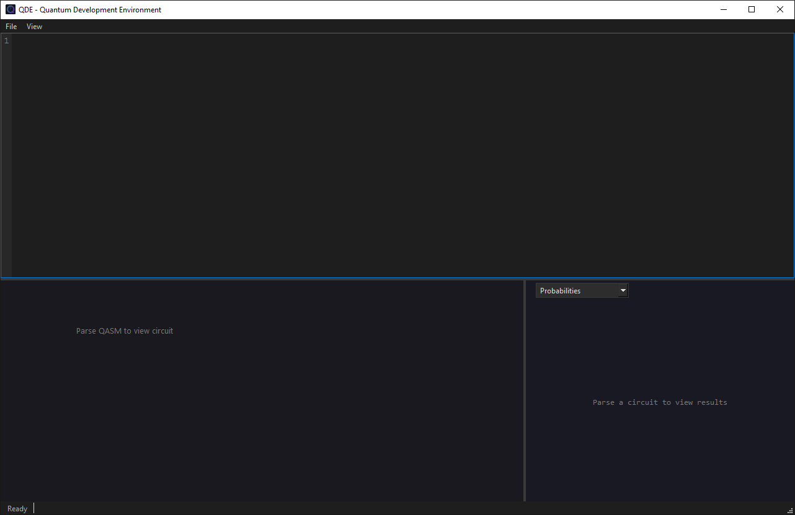
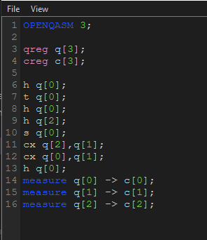
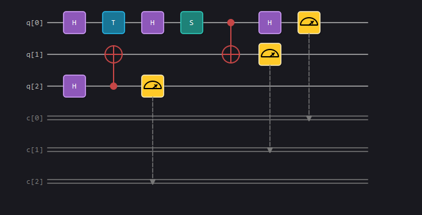
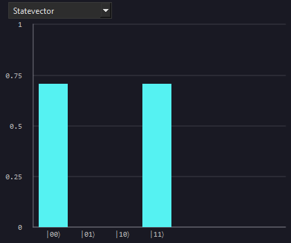
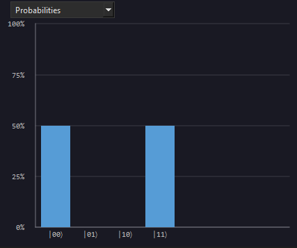

<p align="center">
    
</p>

# QDE: Quantum Development Environment

[](https://www.gnu.org/licenses/gpl-3.0)

[](https://github.com/PogSmok/qde/actions/workflows/ci.yml)
[](https://github.com/PogSmok/qde/actions/workflows/codeql.yml)
[](https://codecov.io/gh/PogSmok/qde)
[](https://www.bestpractices.dev/projects/12988)

QDE is a desktop environment for writing OpenQASM, seeing the circuit, and inspecting the simulated quantum state on
your own machine.

---

## What it is for

Use QDE when you want to check a circuit and its amplitudes without leaving the editor and without sending the program
to a remote backend.

The window is split into three panes: the OpenQASM source on top, the circuit diagram below it, and the simulation
results beside the circuit.

---

## Capabilities

### OpenQASM editor

- **Full OpenQASM 3 Support**. Write and open OpenQASM 3 programs (`.qasm`, `.qasm2`).
- **Live Syntax Validation**. The editor highlights the language and reports when a program
does not parse, so the circuit and the simulation stay tied to a valid source file.

### Circuit view

- Automatically translates valid programs into clear circuit diagrams.
- Display qubit and classical registers, measurements and gates, including user defined gates.

### Simulation results

After a successful parse, QDE runs a local simulation of the circuit and shows the computational-basis state in either
of two views:

- **Probabilities** — the probability of each basis state.
- **Statevector** — amplitudes, with relative phase shown by color.

---

## The interface

<p align="center">
    
</p>

---

**Editor and parse feedback**

<p align="center">
    
</p>

---

**Circuit diagram**
<p align="center">
    
</p>

---

**Probabilities and phase**

<p align="center">
    
    
</p>

---

## How a session works

1. **Write or Open**: Open an existing `.qasm` file or write a program in the editor.
2. **Parse & Render**: When the program parses successfully, the circuit diagram updates automatically.
3. **Simulate**: The local simulator runs on parsed circuit instantly.
4. **Inspect**: Analyze results via basis probabilities, or switch to the statevector view to see amplitudes and
   relative phases.

---

## A short example

A Bell pair:

```qasm
OPENQASM 3.0;
qubit[2] q;
h q[0];
cx q[0], q[1];
```

#### Expected results

The probability view should show equal weight on `|00⟩` and `|11⟩`, and none on `|01⟩` or `|10⟩`.
<p align="center">
    
</p>

---

## Roadmap & Planned features

- [ ] **Step Simulation**:  Advance the circuit one operation at a time and inspect the state after each step.
- [ ] **Export Options**: Export circuit diagrams (SVG/PNG) and simulation data (JSON/CSV).

---

## For developers

Building from source, tests, and the contribution workflow are documented in [CONTRIBUTING.md](CONTRIBUTING.md).

- [Code of Conduct](CODE_OF_CONDUCT.md)

- [Security policy](SECURITY.md)

---

Distributed under the GNU General Public License v3. See [LICENSE](LICENSE).
