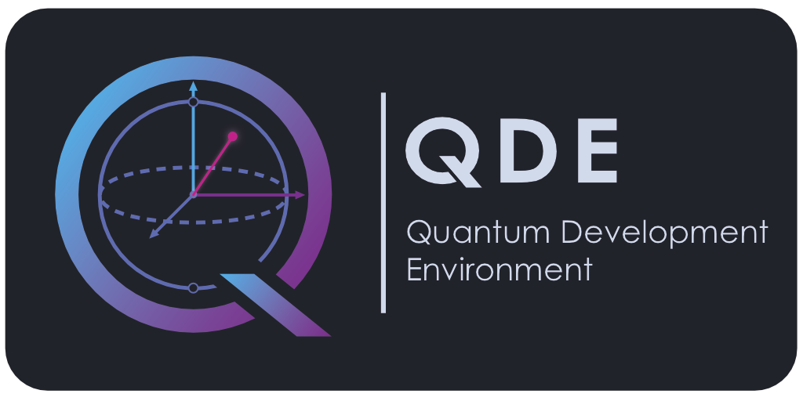

<p align="center">
    
</p>

# QDE: Quantum Development Environment

[](https://www.gnu.org/licenses/gpl-3.0)

QDE is a desktop environment for writing OpenQASM, seeing the circuit, and inspecting the simulated quantum state on
your own machine.

---

## What it is for

Use QDE when you want to check a circuit and its amplitudes without leaving the editor and without sending the program
to a remote backend.

The window is split into three panes: the OpenQASM source on top, the circuit diagram below it, and the simulation
results beside the circuit.

---

## Capabilities

### OpenQASM editor

Write and open OpenQASM 3 programs (`.qasm`, `.qasm2`). The editor highlights the language and reports when a program
does not parse, so the circuit and the simulation stay tied to a valid source file.

### Circuit view

A valid program is drawn as a circuit: qubit and classical registers, gates, and measurements, in program order.

### Simulation results

After a successful parse, QDE runs a local simulation of the circuit and shows the computational-basis state in either
of two views:

- **Probabilities** — the probability of each basis state.
- **Statevector** — amplitudes, with relative phase shown by color.

---

## The interface


---

**Editor and parse feedback**


---

**Circuit diagram**


---

**Probabilities and phase**

<p>
    
    
</p>

---

## Planned features

1. **Step simulation.**  Advance the circuit one operation at a time and inspect the state after each step.

---

## How a session works

1. Open a `.qasm` file or write a program in the editor.
2. When the program parses, the circuit diagram updates.
3. The local simulator runs on that circuit.
4. Read the result as basis probabilities, or switch to the statevector view to see amplitudes and relative phase.

---

## A short example

A Bell pair:

```qasm
OPENQASM 3.0;
qubit[2] q;
h q[0];
cx q[0], q[1];
```

The probability view should show equal weight on `|00⟩` and `|11⟩`, and none on `|01⟩` or `|10⟩`.

---

## For developers

Building from source, tests, and the contribution workflow are documented in [CONTRIBUTING.md](CONTRIBUTING.md).

- [Code of Conduct](CODE_OF_CONDUCT.md)

- [Security policy](SECURITY.md)

---

Distributed under the GNU General Public License v3. See [LICENSE](LICENSE).

[](https://github.com/PogSmok/qde/actions/workflows/ci.yml)
[](https://github.com/PogSmok/qde/actions/workflows/codeql.yml)
[](https://codecov.io/gh/PogSmok/qde)
[](https://www.bestpractices.dev/projects/12988)